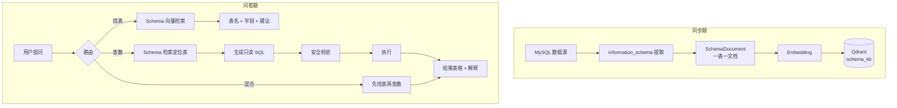

# 一期需求文档：数据库知识库（Schema RAG + NL2SQL）

| 项 | 内容 |
|---|---|
| 文档名称 | 数据库知识库（一期）需求文档 |
| 版本 | v1.0（草案） |
| 日期 | 2026-11-12 |
| 作者 | 产品负责人 |
| 关联仓库 | `learn-spring-boot-chain4j-rag` |
| 上游文档 | `docs/PRD-企业级知识库平台演进.md`（P0/P1 的聚焦版） |
| 文档状态 | 待评审 |

---

## 1. 背景与目标

### 1.1 业务痛点

业务人员知道「数据大概在库里」，但不知道：

- 某类数据到底存在**哪张表**；
- 这张表的**字段是什么意思**；
- 怎么用自然语言**把数据查出来**。

传统做法靠问 DBA、翻数据字典，响应慢且依赖人。

### 1.2 一期目标

> 配置一个 MySQL 连接后，用户可以用自然语言完成两件事：
> **① 找到表**（这类数据存在哪张表）；**② 查出数**（满足条件的数据有哪些）。

### 1.3 典型场景

| # | 用户输入 | 期望结果 |
|---|---|---|
| S1 | “电子病历数据存在哪个表？” | 返回 `e__dzbl`，附中文表名、字段说明、建议查询 |
| S2 | “`e__dzbl` 有哪些字段？” | 返回字段列表、类型、注释、主键 |
| S3 | “`e__dzbl` 里今天生成的数据有哪些？” | 生成 `WHERE create_time >= CURDATE()` 的只读 SQL，返回结果表格 |
| S4 | “病历表里最近 7 天按科室统计数量” | 生成 `GROUP BY` 查询并返回统计结果 |
| S5 | “病人身份证号是多少？” | 命中敏感字段策略，拒绝或脱敏返回 |

---

## 2. 核心概念与分工（必须对齐）

### 2.1 两种能力，两种技术

| 能力 | 技术 | 数据来源 | 是否向量化 |
|---|---|---|---|
| **找表**（Schema Discovery） | 向量检索 + LLM 汇总 | `information_schema` 元数据 | ✅ 是 |
| **查数**（NL2SQL） | LLM 生成 SQL + 校验 + 执行 | 业务表实时数据 | ❌ 否（实时查） |

### 2.2 为什么表数据不整体向量化

| 问题 | 向量检索表现 | 原因 |
|---|---|---|
| “和糖尿病相关的病历” | ✅ | 语义相似 |
| “今天生成的病历” | ❌ | 时间条件不是语义 |
| “一共多少条 / 按科室统计” | ❌ | 需要聚合 |
| “病历号 A123” | ❌ | 需要精确匹配 |
| 新写入的数据 | ❌ | 存在同步延迟 |
| 医疗敏感数据 | ⚠️ | 多一份副本 = 多一份泄露面 |

**结论：** 一期只向量化**元数据**；数据查询走只读 SQL。可选的「样例行」仅用于帮模型理解字段，需脱敏且限量。

### 2.3 什么情况下才考虑数据向量化

- 需要**模糊语义检索**（“类似肺炎描述的病历”），且不要求精确/聚合；
- 数据量可控、更新频率低；
- 已完成脱敏与权限设计。

这属于二期增强，不作为一期范围。

---

## 3. 方案总览



### 3.1 Schema 文档格式（一表一个向量点）

```text
表名: e__dzbl
中文名: 电子病历表
说明: 存储患者电子病历主记录
主键: id
字段:
- id BIGINT 主键，病历ID
- patient_id VARCHAR(32) 患者ID
- dept_code VARCHAR(32) 科室编码
- diagnosis TEXT 诊断内容
- create_time DATETIME 创建时间
索引: idx_patient(patient_id), idx_create_time(create_time)
```

> 设计要点：
> - **一表一个向量点**，保证「找表」返回的是表级结果，而不是零散片段。
> - 表名、中文注释、字段注释都要进文本，中文注释是召回率的关键。
> - 宽表字段过多时，优先保留主键、时间字段、业务关键字段与全部注释，超出长度再截断。

---

## 4. 功能需求

优先级：`P0` 一期必做 · `P1` 一期尽量 · `P2` 二期。

### 4.1 数据源管理

| ID | 需求 | 优先级 | 说明 |
|---|---|---|---|
| FR-1.1 | 新建 MySQL 数据源 | P0 | 主机/端口/库名/账号/密码，密码加密存储 |
| FR-1.2 | 测试连接 | P0 | 返回成功/失败与耗时，不泄露密码 |
| FR-1.3 | 只读账号校验 | P0 | 启动时检测是否具备写权限，有则告警 |
| FR-1.4 | 库/表白名单 | P0 | 只同步允许的表，默认全部业务表 |
| FR-1.5 | 数据源启停 | P1 | 停用后不再参与检索 |

### 4.2 Schema 同步

| ID | 需求 | 优先级 | 说明 |
|---|---|---|---|
| FR-2.1 | 读取 `information_schema` | P0 | 表、字段、类型、注释、主键、索引 |
| FR-2.2 | 生成 SchemaDocument | P0 | 模板化文本，一表一文档 |
| FR-2.3 | 写入向量库 | P0 | 独立 collection `schema_kb`，与文档知识库隔离 |
| FR-2.4 | 同步状态机 | P0 | `PENDING → PROCESSING → READY / FAILED` |
| FR-2.5 | 幂等重建 | P0 | 按「数据源#表名」先删后写 |
| FR-2.6 | 手动触发同步 | P0 | 前端按钮 / API |
| FR-2.7 | 定时同步 | P1 | 每日或表结构变更后 |
| FR-2.8 | 变更检测 | P1 | 表结构变化时提示重建 |
| FR-2.9 | 默认时间字段 | P0 | 每张表标注一个业务时间字段，供「今天/最近 N 天」归一 |
| FR-2.10 | 敏感字段标注 | P0 | 每张表标注需脱敏的列，默认规则见 4.5 |

### 4.3 找表（Schema Discovery）

| ID | 需求 | 优先级 | 说明 |
|---|---|---|---|
| FR-3.1 | 自然语言检索表 | P0 | Top-K 候选表 + 相似度 |
| FR-3.2 | 结果展示 | P0 | 表名、中文名、字段摘要、命中原因 |
| FR-3.3 | 建议查询 | P1 | 给出示例 SQL，便于用户继续查数 |
| FR-3.4 | 表详情 | P0 | 字段列表、类型、注释、主键、索引 |
| FR-3.5 | 多表候选 | P1 | 返回 Top-3 并说明区别 |

### 4.4 查数（NL2SQL）

| ID | 需求 | 优先级 | 说明 |
|---|---|---|---|
| FR-4.1 | 自然语言转 SQL | P0 | 基于命中表结构生成 |
| FR-4.2 | 只读 SQL 校验 | P0 | 仅 `SELECT`；拒绝 DML/DDL/多语句 |
| FR-4.3 | 表白名单 | P0 | 只能查已授权表 |
| FR-4.4 | 强制 LIMIT 与超时 | P0 | 默认 200 行、10 秒 |
| FR-4.5 | 执行与结果返回 | P0 | 表格 + 行数 + 耗时 |
| FR-4.6 | 结果解释 | P0 | 用自然语言总结查询结果 |
| FR-4.7 | SQL 展示与审计 | P0 | 用户可见 SQL，后台留痕 |
| FR-4.8 | 时间语义归一 | P0 | “今天/最近7天”映射到具体字段与时间函数 |
| FR-4.9 | 聚合查询 | P1 | `GROUP BY` / `COUNT` / `SUM` |
| FR-4.10 | 多轮澄清 | P1 | 字段歧义时反问 |

### 4.5 安全与合规（医疗数据重点）

| ID | 需求 | 优先级 | 说明 |
|---|---|---|---|
| FR-5.1 | 敏感字段识别 | P0 | 姓名、身份证、手机号、住址等 |
| FR-5.2 | 默认脱敏 | P0 | 姓名保留姓；身份证保留前 3 后 4；手机号保留前 3 后 4；诊断默认脱敏 |
| FR-5.3 | 字段级权限 | P1 | 不同角色可见字段不同 |
| FR-5.4 | 行级权限 | P2 | 按科室/医生隔离 |
| FR-5.5 | 审计日志 | P0 | 谁、何时、问了什么、执行了什么 SQL |
| FR-5.6 | 禁止全表导出 | P0 | 行数上限 + 无导出接口 |
| FR-5.7 | 提示词注入防护 | P0 | 表注释/数据视为数据，不执行其中指令 |

---

## 5. 交互设计（关键页面）

### 5.1 数据源页

- 数据源卡片：名称、库名、状态、表数量、最后同步时间
- 操作：测试连接、同步 Schema、查看表清单、停用

### 5.2 找表对话框

```text
用户：电子病历数据存在哪个表？

助手：找到 1 张匹配度较高的表：
  表名：e__dzbl（电子病历表）  相似度 0.91
  说明：存储患者电子病历主记录
  关键字段：patient_id 患者ID、diagnosis 诊断内容、create_time 创建时间
  [查看完整字段] [用这张表查数]
```

### 5.3 查数结果

```text
用户：e__dzbl 里今天生成的数据有哪些？

助手：已生成只读查询：
  SELECT id, patient_id, dept_code, diagnosis, create_time
  FROM e__dzbl
  WHERE create_time >= CURDATE()
  LIMIT 200;

返回 37 行（耗时 128ms）：
[表格]
```

---

## 6. 数据模型与接口

### 6.1 新增表

| 表 | 关键字段 |
|---|---|
| `data_source` | id, name, type, host, port, database_name, username, encrypted_password, status, created_at |
| `schema_sync_task` | id, data_source_id, status, table_count, success_count, failed_count, error, started_at, finished_at |
| `schema_table` | id, data_source_id, table_name, table_comment, default_time_column, sensitive_columns, synced_at |
| `query_audit` | id, data_source_id, user, question, sql_text, row_count, cost_ms, success, created_at |

### 6.2 API

| Method | Path | 说明 |
|---|---|---|
| `POST` | `/api/datasources` | 新建数据源 |
| `POST` | `/api/datasources/{id}/test` | 测试连接 |
| `POST` | `/api/datasources/{id}/schema/sync` | 触发 Schema 同步 |
| `GET` | `/api/datasources/{id}/tables` | 表清单 |
| `GET` | `/api/datasources/{id}/tables/{table}` | 表详情 |
| `POST` | `/api/db/ask` | 找表/查数统一入口 |
| `GET` | `/api/db/audit` | 审计查询 |

`POST /api/db/ask` 请求：

```json
{
  "dataSourceId": 1,
  "question": "e__dzbl 里今天生成的数据有哪些？",
  "mode": "AUTO"
}
```

`mode`：`AUTO` / `SCHEMA`（只找表）/ `SQL`（只查数）。

响应（非流式）：

```json
{
  "mode": "SQL",
  "tables": [{"name": "e__dzbl", "comment": "电子病历表", "score": 0.91}],
  "sql": "SELECT ... WHERE create_time >= CURDATE() LIMIT 200",
  "columns": ["id", "patient_id", "..."],
  "rows": [["1", "P001", "..."]],
  "rowCount": 37,
  "costMs": 128,
  "answer": "今天共有 37 条电子病历记录。"
}
```

> SSE 契约保持不变；一期查数采用普通 JSON 响应，避免改动既有事件。

---

## 7. 非功能需求

| 类别 | 要求 |
|---|---|
| 性能 | 找表 P95 ≤ 2s；查数 P95 ≤ 5s（含 LLM） |
| 规模 | 单库 ≤ 2000 张表；Schema 同步 ≤ 5 分钟 |
| 安全 | 只读账号；SQL 白名单；敏感字段脱敏；审计留存 ≥ 180 天 |
| 隔离 | `schema_kb` 与文档知识库分 collection，互不影响 |
| 方言 | 仅保证 MySQL 8.x（CTE / 窗口函数可用），其他方言二期扩展 |
| 可维护 | 新增数据源类型只加 `KnowledgeConnector` 实现 |
| 合规 | 医疗数据不出库；日志不打印敏感值与完整结果集 |

---

## 8. 验收标准

- [ ] 配置 MySQL 后能测试连接并同步全部表结构。
- [ ] 问“电子病历数据存在哪个表”，Top-1 返回 `e__dzbl`。
- [ ] 问“`e__dzbl` 有哪些字段”，返回完整字段、类型与注释。
- [ ] 问“`e__dzbl` 今天生成的数据”，生成带 `CURDATE()` 的 SQL 并返回结果。
- [ ] 问“按科室统计最近 7 天数量”，能生成 `GROUP BY` 并返回统计。
- [ ] `DROP TABLE`、多语句、非白名单表被拒绝。
- [ ] 身份证、手机号等敏感字段默认脱敏。
- [ ] 每次查询都有审计记录（问题、SQL、行数、耗时）。
- [ ] 新增表后重新同步，即可被检索到。
- [ ] 同步失败可在前端看到原因并重试。

---

## 9. 一期范围与非目标

### 9.1 范围

- 单 MySQL 数据源（可扩展多数据源）
- Schema 同步 + 找表 + 查数 + 安全护栏 + 审计
- 前端：数据源管理、找表、查数结果

### 9.2 非目标（二期及以后）

- 全表数据向量化 / 语义检索病历正文
- 写操作、数据修改
- 跨库联邦查询
- CDC 实时同步
- 报表订阅与导出
- 多租户与行级权限（一期只做字段级脱敏）

---

## 10. 风险与待确认事项

| 风险 | 应对 |
|---|---|
| 表注释缺失导致召回差 | 允许人工补充业务别名/描述 |
| 字段歧义（多个时间字段） | 配置默认时间字段 + 多轮澄清 |
| NL2SQL 生成错误 | 展示 SQL、限制只读、评估集回归 |
| 医疗敏感数据泄露 | 脱敏 + 字段权限 + 审计 + 最小化返回 |
| 大表查询拖垮库 | 只读从库、超时、行数上限、限流 |

### 10.1 已确认决策（2026-11-12）

| 决策项 | 结论 | 对实现的影响 |
|---|---|---|
| SQL 执行 | **允许真正执行**，只读 + 白名单 + 强制 LIMIT + 超时 | 一期实现执行器与审计，不做「仅生成」分支 |
| 数据库 | **MySQL 8.x** | SQL 生成提示词按 MySQL 8 方言；可用 CTE/窗口函数 |
| 时间语义 | **按表配置默认时间字段** | `schema_table.default_time_column`；缺失时反问用户 |
| 敏感数据 | **默认脱敏** | 建立列级敏感规则 + 统一掩码器 |

### 10.2 剩余待确认

1. 是否可提供只读从库（避免查询影响业务库）？
2. 大约多少张表、多少字段？是否需要支持多个库/schema？
3. 使用者角色：只有管理员，还是医生/科室也需要分权（决定是否一期就做行级权限）？
4. 敏感字段清单是否包含：姓名、身份证、手机号、住址、诊断、病历正文？

## 11. 实现状态（2026-11-12）

| 能力 | 状态 |
|---|---|
| 数据源连接配置（环境变量） | ✅ 已完成 |
| Schema 同步（`information_schema` → `schema_kb`，一表一文档） | ✅ 已完成，测试库 1107 张表 |
| 找表（Schema RAG） | ✅ 已完成 |
| 主表优先 rerank（明细/共享/备份/日志降权） | ✅ 已完成 |
| 查数（NL2SQL：生成 → 校验 → 只读执行 → 结果表格） | ✅ 已完成 |
| 多表 JOIN / 按需扩展表结构 | ✅ 已完成 |
| 敏感字段脱敏 | ✅ 已完成（含拼音列名） |
| 审计 | 🟡 应用日志已记录；独立审计表待做 |
| 数据源持久化 / 前端数据源管理 | ⬜ 未做（当前用环境变量） |
| 行级权限 / 多租户 | ⬜ 未做 |
| 评估集与回归 | ⬜ 未做 |
| 样例行 / 全量数据向量化 | ⬜ 未做（建议不做全量） |
