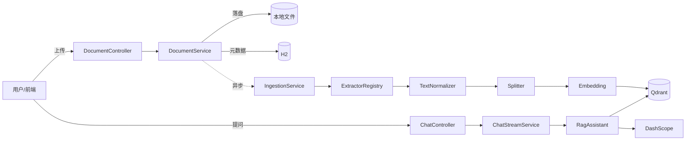
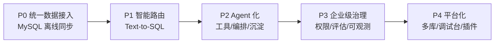
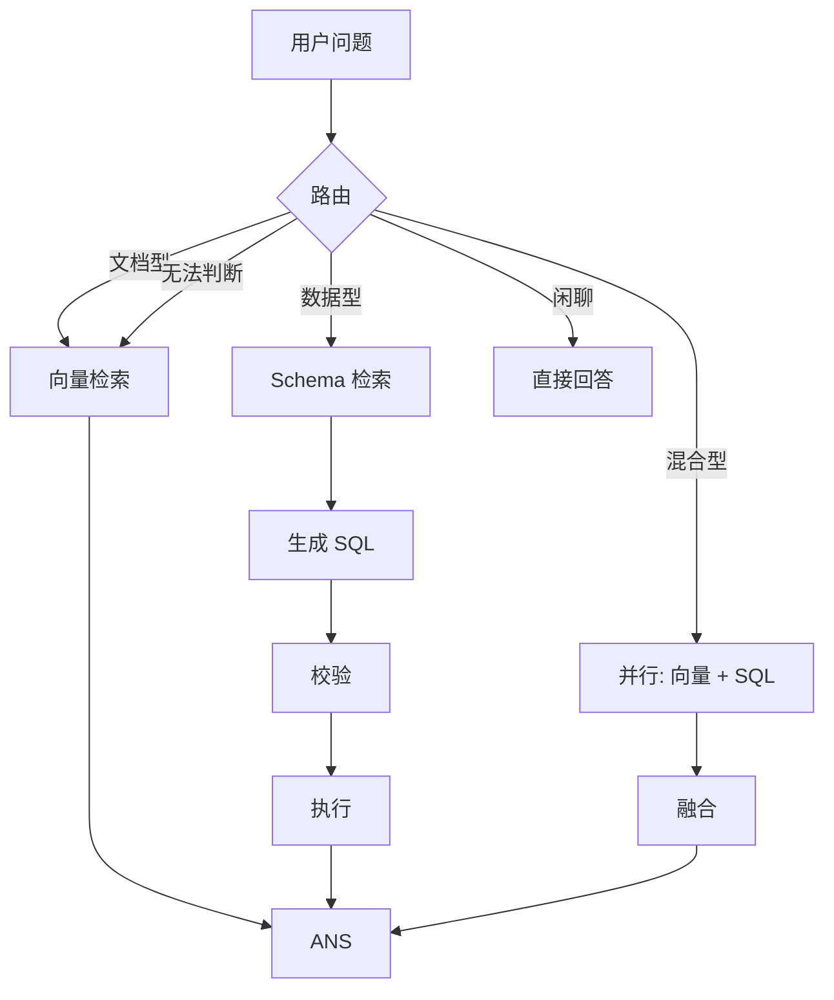

# 企业级知识库平台演进需求文档（PRD）

| 项 | 内容 |
|---|---|
| 文档名称 | 企业级知识库平台演进需求文档 |
| 版本 | v1.0（草案，待评审） |
| 日期 | 2026-11-12 |
| 作者 | 产品负责人（高级总监视角） |
| 关联仓库 | `learn-spring-boot-chain4j-rag` |
| 文档状态 | 草案 / 待排期 |

> 阅读建议：第 3 章是**方向判断**，先看；第 5 章是**可执行需求**，按阶段实施；第 11 章是**你要补齐的能力地图**。

---

## 1. 背景与现状

### 1.1 已具备的能力

| 能力 | 现状 |
|---|---|
| 知识来源 | 仅用户上传的 `.md` / `.txt` / `.pdf`（文字层） |
| 入库链路 | 上传 → 校验落盘 → 异步提取/规范化/切分/embedding → Qdrant |
| 状态管理 | `PENDING → PROCESSING → READY / FAILED`，支持重建与失败追溯 |
| 检索问答 | Qdrant top-5 + SSE 流式输出 + 引用来源 |
| 会话 | 进程内 `MessageWindowChatMemory`，按 conversationId 隔离 |
| 扩展性 | 文件类型已抽象为 `TextExtractorRegistry` 策略注册表 |
| 运维 | 启动恢复、维度校验、删除竞态处理 |

### 1.2 现状架构



### 1.3 差距分析

| 维度 | 现状 | 企业级要求 | 差距 |
|---|---|---|---|
| 数据源 | 仅手工上传文件 | 结构化库、业务系统、SaaS 多源接入 | **大** |
| 查询能力 | 只能语义检索 | 需要精确数值、聚合、实时数据 | **大** |
| 智能体 | 单一 RAG 助手 | 工具调用 / 多 Agent 协作 | **大** |
| 权限 | 无鉴权、单租户 | 多租户、文档级 ACL | **极大** |
| 质量 | 无评估集 | 离线评估 + 回归门禁 | **极大** |
| 可观测 | 仅日志 | Trace / 指标 / 成本 / badcase | **大** |
| 治理 | 无去重、版本、过期 | 知识生命周期管理 | **大** |

**结论：** 项目已跨过「能跑通 RAG」的门槛，下一阶段的核心不是再加一个检索技巧，而是把它从**Demo** 升级为**可接入、可回答、可信赖、可运营**的知识平台。

---

## 2. 产品定位与目标

### 2.1 一句话定位

> 一个**统一接入多源数据、能自动选择检索或查库、并对答案负责**的企业知识中枢。

### 2.2 目标用户

| 角色 | 核心诉求 |
|---|---|
| 业务使用者 | 用自然语言问到准确答案，且能追溯到出处 |
| 知识运营 | 管数据源、看同步状态、处理失败、治理知识质量 |
| 数据/平台工程师 | 接入新数据源、配置 Agent、排障与调优 |
| 管理者 | 看到使用量、满意度、成本与风险 |

### 2.3 度量指标

**北极星指标：一次问答解决率**（用户未追问/未点踩即视为解决）。

| 层级 | 指标 | 目标（首年） |
|---|---|---|
| 效果 | 答案忠实度 faithfulness | ≥ 0.90 |
| 效果 | 检索召回 recall@5 | ≥ 0.85 |
| 效果 | 合理拒答率（无依据时明说） | ≥ 0.95 |
| 体验 | 首 token 延迟 P95 | ≤ 2s |
| 体验 | 完整回答 P95 | ≤ 12s |
| 运营 | 入库成功率 | ≥ 99% |
| 成本 | 单次问答 token 成本 | 环比可控 |

---

## 3. 核心产品判断（先定方向）

这一章回答「为什么这么做」，避免为了炫技堆功能。

### 3.1 MySQL 接入：不是一种模式，而是三种

用户提出的「Agent 判断 → 取 MySQL → 上传向量库 → 返回」，实际混合了两件事：**实时查询** 和 **知识沉淀**。二者目标不同，必须拆开。

| 模式 | 做法 | 适合的问题 | 优点 | 代价 |
|---|---|---|---|---|
| **A. 离线同步（ETL→向量库）** | 定时把表/视图转文本、切分、embedding 写入 Qdrant | 产品目录、FAQ、工单归档等稳定语料 | 与文档统一检索、延迟低、成本低 | 不实时；表格结构转文本有损 |
| **B. 在线查询（Text-to-SQL）** | Agent 生成只读 SQL 实时执行 | 「上月华东销售额」「订单 123 的状态」 | 实时、精确、可聚合 | 延迟高；SQL 生成有风险；需 schema 治理 |
| **C. 路由/混合（推荐）** | 先判定问题类型，再选 A/B 或融合 | 真实企业问题 | 扬长避短 | 需要路由与融合策略 |

**产品结论：**
1. **不要把所有表无脑向量化**——数值/实时/聚合类问题向量检索天然答不准。
2. **不要每次都实时查库**——稳定语料应预索引，否则延迟与成本不可控。
3. **「回写向量库」应为异步知识沉淀**（把高频问答/SQL 结论沉淀为知识），**不阻塞本次回答**。
4. 第一阶段先做 **A（离线同步）**，因为它复用现有入库链路，风险最低、见效最快；**B 放在第二阶段**，因为需要护栏、schema 治理与评估。

### 3.2 多 Agent：渐进式，而非一步到位

| 阶段 | 形态 | 何时采用 |
|---|---|---|
| L1 | 单 Agent + 工具调用（Tool Calling） | **先做这个**，80% 场景够用 |
| L2 | 路由 Agent + 专职子 Agent（检索/查库） | 工具明显分域、互相干扰时 |
| L3 | 编排工作流 + 评审 Agent（Critic） | 需要多步推理、结果校验时 |
| L4 | 自主规划 Agent | 仅在高价值、可回滚场景试点 |

**反模式警告：**
- 一上来就做「多 Agent 自治」→ token 放大 3~10 倍、延迟飙升、问题难定位。
- Agent 越多不等于越聪明，**边界清晰**比数量重要。
- 没有评估集就调 Agent = 盲调。

### 3.3 三条必须写进规范的红线

1. **SQL 只读 + 白名单 + 强制 LIMIT + 超时**，禁止 LLM 直接执行任意 SQL。
2. **权限在检索层过滤**，不能「先检索到再在前端隐藏」。
3. **答案必须有出处**（文档 chunk 或 SQL 结果），无依据时必须拒答。

---

## 4. 演进路线总览



| 阶段 | 主题 | 核心交付 | 学习价值 |
|---|---|---|---|
| **P0** | 让知识库「有货」 | 数据源 SPI、MySQL 连接器、增量同步、管理台 | ETL、增量水位、幂等、连接器架构 |
| **P1** | 让知识库「会用数」 | Query 路由、Schema 检索、Text-to-SQL 护栏、结果融合 | Agent 工具调用、SQL 安全、混合检索 |
| **P2** | 让知识库「会办事」 | 工具注册、专职 Agent、编排、知识沉淀回写 | 多 Agent 编排、工作流、状态管理 |
| **P3** | 让知识库「可信可运营」 | 多租户 ACL、评估体系、Trace、反馈闭环 | 权限模型、RAG 评估、可观测性 |
| **P4** | 让知识库「可复制」 | 多知识库、Agent 调试台、插件市场 | 平台化、多租户 SaaS 架构 |

---

## 5. 详细需求

优先级定义：`P0` 必须做 · `P1` 应该做 · `P2` 可延后。

### 阶段 P0：统一数据接入（MySQL 离线同步）

**目标：** 让知识库不只吃文件，还能吃结构化数据，且接入方式可扩展。

#### 5.1 需求清单

| ID | 需求 | 优先级 | 说明 |
|---|---|---|---|
| FR-0.1 | 数据源抽象层 | P0 | 新增 `KnowledgeConnector` SPI，与 `TextExtractorRegistry` 同构 |
| FR-0.2 | MySQL 连接器 | P0 | 读取表/视图，按模板把行转文本 |
| FR-0.3 | 数据源管理 API | P0 | 增删改查、测试连接、启停 |
| FR-0.4 | 同步任务与状态机 | P0 | 复用 `PENDING/PROCESSING/READY/FAILED` 思路 |
| FR-0.5 | 增量同步（水位线） | P0 | 基于 `updated_at` / 自增主键 |
| FR-0.6 | 幂等与去重 | P0 | 稳定 docId = `source:conn:table:pk` |
| FR-0.7 | 字段脱敏与只读账号 | P0 | 列级白/黑名单 |
| FR-0.8 | 同步管理前端 | P1 | 数据源卡片、同步进度、失败重试 |
| FR-0.9 | CDC 实时同步 | P2 | Debezium/binlog，进阶 |

#### 5.2 关键设计：连接器 SPI

沿用项目已有的策略注册表思想，新增：

```text
KnowledgeConnector (interface)
  ├─ connectorType(): "mysql" | "postgres" | "http" | "feishu" ...
  ├─ testConnection(config): ConnectionTestResult
  └─ fetch(config, cursor): ConnectorBatch
        └─ List<RawDocument> { externalId, title, content, metadata, updatedAt }
```

**约束（与现有规范一致）：**
- `IngestionService` / `DocumentService` **不出现**按数据源类型的 `if/switch`。
- 连接器只负责「外部数据 → RawDocument」，规范化、切分、embedding 复用现有链路。
- 新增数据源 = 新增一个 `@Component implements KnowledgeConnector`。

#### 5.3 行转文本模板

默认模板可配置，示例：

```text
[表: orders] 订单号: {{order_no}}
客户: {{customer_name}} | 状态: {{status}} | 金额: {{amount}} 元
下单时间: {{created_at}} | 地区: {{region}}
备注: {{remark}}
```

- 长文本字段（`TEXT`）单独成段，短字段拼接。
- 空值跳过，避免生成 `null` 噪声。
- 模板变更需触发该数据源全量重建。

#### 5.4 增量同步策略

| 策略 | 适用 | 说明 |
|---|---|---|
| 全量 | 小表、首次 | 分页拉取，限速 |
| 水位线增量 | 有 `updated_at` | 记录 `lastSyncAt`，`WHERE updated_at > ?` |
| 主键增量 | 只增不改 | `WHERE id > lastId` |
| CDC | 强实时 | P2，独立组件 |

#### 5.5 验收标准

- [ ] 配置 MySQL 数据源后，可在前端触发同步，状态可观测。
- [ ] 10 万行表分页同步不 OOM，可断点续传。
- [ ] 重复同步不产生重复向量（按外部 ID 幂等）。
- [ ] 删除数据源会清理其全部向量与文档记录。
- [ ] 新增第二种数据源（如 PostgreSQL）无需改核心服务。

---

### 阶段 P1：智能路由与 Text-to-SQL

**目标：** 让系统能判断「该查文档还是查库」，并安全地查库。

#### 6.1 需求清单

| ID | 需求 | 优先级 | 说明 |
|---|---|---|---|
| FR-1.1 | Query 意图分类 | P0 | `DOC / SQL / HYBRID / CHITCHAT` |
| FR-1.2 | Schema 索引 | P0 | 表名/列名/注释/枚举 → 向量索引 |
| FR-1.3 | Schema 检索（RAG for SQL） | P0 | 只把相关表结构喂给模型 |
| FR-1.4 | Text-to-SQL 生成 | P0 | few-shot + 方言约束 |
| FR-1.5 | SQL 安全护栏 | P0 | 见 6.3 |
| FR-1.6 | 执行与结果摘要 | P0 | 小结果直接摘要，大结果给表格 |
| FR-1.7 | 混合融合 | P1 | 文档 + SQL 结果合并作答 |
| FR-1.8 | SQL 审计日志 | P0 | SQL、耗时、行数、用户 |
| FR-1.9 | 结果表格 SSE 事件 | P1 | 新增事件，不破坏现有契约 |

#### 6.2 路由设计



**路由实现建议：**
- 先用**规则 + 轻量分类**（关键词如「多少/统计/占比/最新」），准确率不够再上 LLM 分类。
- 路由结果要可解释、可记录，便于调优。
- 允许用户显式指定模式（前端「仅文档 / 仅数据 / 自动」）。

#### 6.3 SQL 安全护栏（红线）

| 层级 | 措施 |
|---|---|
| 账号 | 只读账号，库级/表级授权 |
| 语法 | 仅允许单条 `SELECT`；拒绝 DML/DDL/多语句/注释注入 |
| 对象 | 表白名单；禁止系统表 |
| 行数 | 强制 `LIMIT`（默认 200） |
| 超时 | 语句超时 + 连接超时 |
| 权限 | 按用户/租户注入 `WHERE` 条件（行级权限） |
| 数据 | 敏感列脱敏；结果不落盘 |
| 审计 | 全量记录，可回溯 |

#### 6.4 验收标准

- [ ] 「文档里提到的报销流程是什么」走文档检索。
- [ ] 「上月订单总额是多少」走 SQL 并返回正确数值。
- [ ] 恶意输入（`DROP TABLE`、`; --`）被拦截并给出可读提示。
- [ ] 单次 SQL 查询 P95 ≤ 3s，且不超过行数/超时限制。
- [ ] 每条答案可展示来源：文档 chunk 或 SQL + 结果集。

---

### 阶段 P2：Agent 化

**目标：** 从「问答」走向「可调用工具完成任务的助手」。

#### 7.1 需求清单

| ID | 需求 | 优先级 | 说明 |
|---|---|---|---|
| FR-2.1 | 工具注册表 | P0 | 类 `@Tool`，统一注册/发现 |
| FR-2.2 | 内置工具 | P0 | 文档检索、SQL 查询、数据源同步、时间/计算 |
| FR-2.3 | 专职子 Agent | P1 | RagAgent / SqlAgent / SyncAgent |
| FR-2.4 | 编排工作流 | P1 | 确定性流程优先，非全自治 |
| FR-2.5 | 评审 Agent（Critic） | P2 | 事实性/引用校验 |
| FR-2.6 | 高危操作人审 | P0 | 写操作/大批量同步需确认 |
| FR-2.7 | 知识沉淀回写 | P1 | 高频问答异步写回向量库 |
| FR-2.8 | Agent 运行轨迹 | P1 | 每步工具、输入输出、耗时 |

#### 7.2 多 Agent 边界

| Agent | 职责 | 输入 | 输出 |
|---|---|---|---|
| Router | 判型与分派 | 用户问题 | 路由决策 |
| RagAgent | 文档检索与作答 | 问题 | 带引用答案 |
| SqlAgent | 查库与摘要 | 问题 + schema | 数值 + SQL |
| SyncAgent | 触发/查询同步任务 | 自然语言指令 | 任务状态 |
| Critic | 校验答案与引用 | 草稿 + 证据 | 通过/打回 |

**编排原则：**
- 优先**工作流（状态机）**，只在确实需要时用模型自主规划。
- 每个 Agent 有明确输入输出契约，可单独测试。
- 任何写操作必须可审计、可回滚、可人工确认。

#### 7.3 知识沉淀回写

```text
问答/查询完成 → 异步事件 → 沉淀判定（是否高频/高价值）
  → 生成结构化知识条目 → 去重 → 入库（标记 source=auto）
```

- **不阻塞**本次回答。
- 沉淀内容需标注来源与置信度，避免污染知识库。
- 需人工审核队列（P2 可简化为自动 + 抽样审核）。

---

### 阶段 P3：企业级治理

**目标：** 让系统「可信、可控、可运营」。

#### 8.1 多租户与权限

| ID | 需求 | 优先级 |
|---|---|---|
| FR-3.1 | 租户/工作空间隔离 | P0 |
| FR-3.2 | 文档级 ACL（标签/角色） | P0 |
| FR-3.3 | 检索时过滤（Qdrant filter） | P0 |
| FR-3.4 | SQL 行级权限 | P0 |
| FR-3.5 | 审计日志 | P0 |

- Qdrant payload 新增 `tenantId`、`aclTags`，检索时强制注入 filter。
- 实体新增 `tenantId`，所有查询默认带租户条件。

#### 8.2 评估体系

| ID | 需求 | 优先级 |
|---|---|---|
| FR-4.1 | 黄金评估集（50~100 题） | P0 |
| FR-4.2 | 离线自动评估 | P0 |
| FR-4.3 | 回归门禁（CI） | P1 |
| FR-4.4 | 在线抽样评估 | P2 |

**指标：** faithfulness、answer relevancy、context precision/recall、SQL 执行正确率、拒答准确率。

**做法：** 用 LLM-as-Judge + 人工抽检校准；评估集进仓库，版本化。

#### 8.3 可观测性

| ID | 需求 | 优先级 |
|---|---|---|
| FR-5.1 | Trace（每次问答全链路） | P0 |
| FR-5.2 | 指标（延迟/token/成本/命中率） | P0 |
| FR-5.3 | badcase 收集 | P1 |
| FR-5.4 | 告警（错误率/延迟/成本） | P1 |

#### 8.4 反馈闭环

- 点赞/点踩 + 原因标签 → badcase 库 → 归因（检索缺失 / 切分问题 / 提示词 / 数据源）→ 修复 → 回归。

#### 8.5 安全与合规

- Prompt 注入防护：检索内容视为数据，不执行其中指令。
- PII 识别与脱敏。
- 密钥托管（环境变量 → 密钥管理服务）。
- 数据保留与删除策略。
- 成本与限流：按租户配额、熔断降级。

---

### 阶段 P4：平台化

| ID | 需求 | 说明 |
|---|---|---|
| FR-6.1 | 多知识库 | 一个租户多个库，独立 collection/过滤 |
| FR-6.2 | Agent 调试台 | 看检索结果、工具调用、重放问题 |
| FR-6.3 | 插件/工具市场 | 第三方连接器与工具注册 |
| FR-6.4 | 模板市场 | 行业知识库模板 |
| FR-6.5 | 开放 API / Webhook | 对外集成 |

---

## 9. 非功能需求（NFR）

| 类别 | 要求 |
|---|---|
| 性能 | 首 token P95 ≤ 2s；问答 P95 ≤ 12s；同步吞吐可配置限速 |
| 可用性 | 核心问答可用性 ≥ 99.5%；外部依赖故障时降级为「仅文档」 |
| 扩展性 | 新增数据源不改核心服务；连接器可插拔 |
| 安全 | SQL 只读 + 白名单 + 限流；检索层强制权限过滤；PII 脱敏 |
| 成本 | 单问答 token 有预算上限；embedding 批量与缓存；语义缓存（P2） |
| 可维护性 | 全链路 traceId；错误码统一；配置外置 |
| 合规 | 审计日志保留 ≥ 180 天；数据可删除 |

---

## 10. 数据模型与接口变更

### 10.1 新增数据表

| 表 | 关键字段 |
|---|---|
| `data_source` | id, tenant_id, type, name, config_json, status, created_at |
| `sync_task` | id, data_source_id, mode, status, cursor, total, success, failed, error, started_at, finished_at |
| `document`（扩展） | + source_type, source_ref, external_id, tenant_id |
| `conversation` / `message` | 会话与消息持久化（替代进程内记忆） |
| `feedback` | message_id, rating, reason, comment |
| `eval_case` / `eval_run` | 评估集与运行结果 |
| `audit_log` | actor, action, target, detail, created_at |

### 10.2 Qdrant payload 扩展

| 键 | 说明 |
|---|---|
| `docId` | 已有 |
| `sourceType` | `file` / `mysql` / ... |
| `sourceRef` | 数据源/表/主键 |
| `tenantId` | 租户隔离 |
| `aclTags` | 权限标签 |

> 注意：键名仍不得包含 `.`（见 `MetadataKeys` 约定）。

### 10.3 新增 API（示例）

| Method | Path | 说明 |
|---|---|---|
| `POST` | `/api/datasources` | 创建数据源 |
| `POST` | `/api/datasources/{id}/test` | 测试连接 |
| `POST` | `/api/datasources/{id}/sync` | 触发同步 |
| `GET` | `/api/datasources/{id}/tasks` | 同步任务列表 |
| `GET` | `/api/chat/stream` | 扩展：新增 `route`、`table` 事件 |
| `POST` | `/api/feedback` | 提交反馈 |

> SSE 已有事件名（`meta/sources/token/done/error`）**保持不变**；新增事件属于向后兼容扩展。

---

## 11. 能力地图：这个项目能让你练到什么

| 能力域 | 具体能力 | 对应阶段 |
|---|---|---|
| **数据工程** | ETL、增量同步、水位线、幂等、断点续传、CDC | P0 |
| **架构设计** | SPI/插件化、连接器模式、状态机、异步任务 | P0/P2 |
| **LLM 工程** | Tool Calling、Text-to-SQL、RAG 评估、提示词工程 | P1/P3 |
| **Agent 系统** | 路由、编排、边界划分、人审、可观测 | P2 |
| **检索进阶** | 混合检索（向量+关键词+结构化）、重排、融合 | P1 |
| **安全** | SQL 注入防护、Prompt 注入、PII、行级权限 | P1/P3 |
| **平台化** | 多租户、配额、审计、插件市场 | P3/P4 |
| **产品能力** | 指标设计、评估闭环、badcase 运营 | 全阶段 |

**最值得优先补齐的三项「企业级硬技能」：**
1. **评估体系**（没有它，AI 功能无法上线）。
2. **检索层权限**（没有它，无法进入企业）。
3. **可观测性**（没有它，线上问题无法定位）。

---

## 12. 风险与依赖

| 风险 | 影响 | 应对 |
|---|---|---|
| Text-to-SQL 生成错误 | 回答错误 | schema 治理 + few-shot + 评估 + 置信度阈值 |
| 同步拖垮业务库 | 生产事故 | 只读从库、限速、低峰调度 |
| 向量与源数据不一致 | 答案过期 | 增量 + 定期全量校验 + 版本字段 |
| 多 Agent 成本失控 | 预算超支 | token 预算、路由降级、缓存 |
| 权限遗漏 | 数据泄露 | 检索层强制过滤 + 测试用例 |
| 评估集过拟合 | 指标虚高 | 定期补充新题、人工抽检 |

**依赖：** MySQL 只读实例、Qdrant 新 collection/payload 索引、评估用的 LLM 配额。

---

## 13. 里程碑建议

| 迭代 | 周期 | 交付 | 验收 |
|---|---|---|---|
| M1 | 1~2 周 | 连接器 SPI + MySQL 全量同步 + 管理 API | 能把一张表同步进知识库并问答 |
| M2 | 1~2 周 | 增量同步 + 幂等 + 前端管理台 | 重复同步无重复、失败可重试 |
| M3 | 2 周 | 路由 + Schema 检索 + Text-to-SQL 护栏 | 数据类问题答对且被审计 |
| M4 | 2 周 | 工具注册 + RagAgent/SqlAgent | 单 Agent 能自主选工具 |
| M5 | 2 周 | 评估集 + Trace + 权限过滤 | 指标可量化、租户隔离生效 |

> 每个里程碑结束都应满足：`./mvnw -q test` 通过、前端 `npm run build` 通过、README/错误码/配置同步更新（见 `CLAUDE.md` 第 10 节）。

---

## 14. 附录：术语表

| 术语 | 含义 |
|---|---|
| RAG | 检索增强生成 |
| ETL | 抽取-转换-加载 |
| CDC | 变更数据捕获 |
| Text-to-SQL | 自然语言生成 SQL |
| ACL | 访问控制列表 |
| faithfulness | 答案是否忠实于检索证据 |
| recall@k | 前 k 条检索结果覆盖正确答案的比例 |
| badcase | 回答错误/体验差的样本 |
| SPI | 服务提供者接口（可插拔扩展点） |

---

## 15. 待决策项（需你拍板）

1. **数据源优先级**：先做 MySQL，还是同时做 HTTP/飞书等 API 数据源？
2. **实时性要求**：业务能否接受 T+1 / 每小时同步，还是必须 CDC？
3. **权限粒度**：只需租户隔离，还是必须文档级 + 行级？
4. **部署形态**：单机学习项目，还是按多租户 SaaS 设计？
5. **评估投入**：是否愿意先花时间建 50 题黄金集（强烈建议）。
