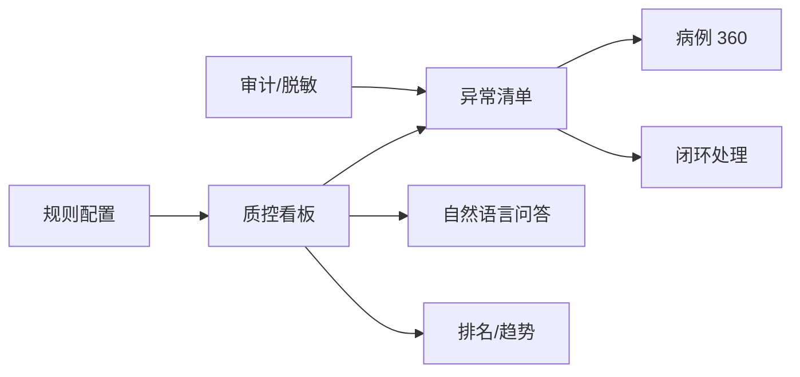
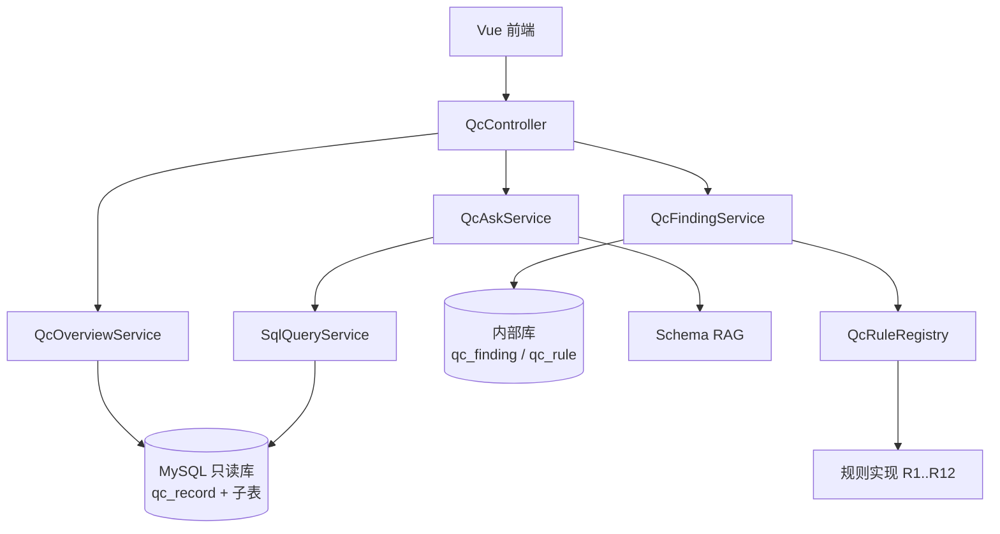

# 手术质控助手：产品需求与技术方案

| 项 | 内容 |
|---|---|
| 文档名称 | 手术质控助手产品需求与技术方案 |
| 版本 | v1.0 |
| 日期 | 2026-11-12 |
| 业务域 | 植发手术质控 |
| 目标库 | `wisecloudcrm_13604`（MySQL 5.7.44） |
| 关联文档 | `docs/PRD-企业级知识库平台演进.md`、`docs/PLAN-数据库知识库-一期补完与二期规划.md` |
| 文档状态 | 待评审 |
| 目标读者 | 产品、质控业务方、后端、前端、测试 |

---

## 0. 一页纸摘要

### 0.1 一句话定位

> 把手术质控从“人工翻 5 张表、凭经验抽查”，变成“每天自动列出需要处理的异常，并能用自然语言追问原因”。

### 0.2 目标用户

| 角色 | 核心诉求 |
|---|---|
| 质控护士 | 今天有哪些病例缺数据、状态不对、需要补？ |
| 质控主管 / 医务 | 哪些分院/医生问题多？归档及时吗？异常手术复盘了吗？ |
| 分院院长 | 本院质控达标了吗？和别的院差在哪？ |
| 手术医生 | 我的病例有没有被退回/异常？ |
| IT / 数据 | 规则怎么配？口径是什么？数据为什么不准？ |

### 0.3 核心业务价值

1. **省时间**：把“逐条翻记录”变成“只看异常清单”。
2. **降风险**：缺项、状态不同步、归档超时在当天被发现，而不是审计时才发现。
3. **可考核**：分院/医生/护士的质控指标口径统一、可追溯。
4. **可复盘**：异常终止、麻醉超时、数量异常有据可查。

### 0.4 MVP 范围

- 1 个质控看板
- 8 条高频异常规则
- 异常清单 + 病例 360
- 自然语言问答（限定质控范围）
- 异常闭环（认领 / 处理 / 忽略）
- 脱敏与审计

### 0.5 真实数据基线（2026-11-12 采样）

| 指标 | 数值 | 说明 |
|---|---|---|
| 有效主记录 | **115** | `del_flag = 0` |
| 状态=0 未开始 | **38** | 仅开台阶段 |
| 状态=5 已失效 | **52** | 列注释写 -5，实际数据为 5，需确认 |
| 应收数记录（状态 1~4） | **25** | 进行中/已完成/异常终止/已归档 |
| 状态=1 但阶段=FINISHED | **7** | 状态未及时更新，占“进行中”10 条的 70% |
| 缺麻醉（按阶段应收） | **4** | 已到麻醉及之后阶段但没有麻醉数据 |
| 缺取发（按阶段应收） | **4** | 已到取发及之后阶段但没有取发数据 |
| 缺种植（按阶段应收） | **2** | 已到种植及之后阶段但没有种植数据 |
| 缺开台配置（状态 1~4） | **1** | — |
| 异常终止 | **3** | 需要复盘 |
| 已归档 | **8** | 平均归档 3.4 天，最长 **21 天** |
| 麻醉记录 | **48** | 平均 6.3 分钟，最长 **95 分钟** |

> 这些数字说明：**问题不是“没有数据”，而是“数据分散、状态不同步、缺项发现太晚”**。这正是质控助手要解决的。

### 0.6 成功指标（90 天）

| 指标 | 目标 |
|---|---|
| 异常闭环率 | ≥ 85% |
| 状态/阶段不一致 | 0 条 |
| 应收阶段缺项率 | < 5% |
| 7 天内归档率 | ≥ 90% |
| 人工复核时长 | 下降 50% |
| 规则误报率 | < 15% |

---

## 1. 业务背景

### 1.1 植发手术质控链路

```text
SETUP（开台）
  → ANESTHESIA（麻醉）
  → EXTRACTION（取发/分离）
  → PLANTING（种植）
  → FINISHED（手术结束）
```

主记录与子表关系：

```text
hospital_surgical_qc_record（主记录）
  ├─ 1:1 hospital_surgical_qc_setup（开台配置）
  ├─ 1:1 hospital_surgical_qc_anesthesia（麻醉）
  ├─ 1:1 hospital_surgical_qc_extraction（取发/分离）
  └─ 1:1 hospital_surgical_qc_planting（种植）
```

主记录关键字段：

| 字段 | 含义 |
|---|---|
| `record_no` | 质控记录编号 |
| `wise_depart_id/name` | 分院 |
| `surgery_date` | 手术日期 |
| `current_stage` | 当前阶段：SETUP/ANESTHESIA/EXTRACTION/PLANTING/FINISHED |
| `qc_status` | 0 未开始 / 1 进行中 / 2 已完成 / 3 异常终止 / 4 已归档 / 5 已失效（注释写 -5，需确认） |
| `transplant_technique` | 1 常规植发 / 2 长发植发，逗号分隔 |
| `operation_id` | 手术医生 |
| `qc_nurse_id/name` | 质控责任护士 |
| `account_id/code/name` | 客户 |
| `case_id` / `dzbl_no` | 病历记录编号 / 电子病历 ID |
| `charge_order_id` | 收费单 |
| `surgery_start_time` / `surgery_end_time` | 手术开始/结束 |
| `filed_time` / `filed_by` | 归档时间/人 |
| `del_flag` | 0 正常 / 1 删除 |

### 1.2 现状痛点

| 痛点 | 表现 | 影响 |
|---|---|---|
| 数据分散 | 5 张表，人工逐条核对 | 复核慢、易漏 |
| 状态不同步 | 状态=1 但阶段=FINISHED，7 条 | 看板失真、交接误判 |
| 缺项滞后 | 到种植阶段仍缺麻醉/取发数据 | 审计/复诊/纠纷风险 |
| 归档超时 | 最长 21 天，目标 7 天 | 合规风险 |
| 异常复盘弱 | 异常终止只有状态，无结构化原因 | 无法改进 |
| 口径不统一 | 不同人统计方式不同 | 管理决策失真 |

### 1.3 机会与价值假设

| 价值 | 假设 | 验证方式 |
|---|---|---|
| 时间 | 单例人工核对 5~10 分钟，异常清单可替代 60%+ | 上线前后计时对比 |
| 风险 | 缺项在当天发现，整改成本远低于审计时 | 缺项闭环时长 |
| 及时 | 归档超时自动提醒，7 天归档率提升 | 归档天数分布 |
| 质量 | 异常终止结构化复盘，降低重复发生 | 异常终止率趋势 |
| 管理 | 分院/医生排名口径统一 | 指标一致性抽查 |

> 以上是**待验证假设**，不是承诺。上线后用数据校准。

---

## 2. 产品定位与边界

### 2.1 一句话定位

> 质控护士的“每日工作清单” + 质控主管的“质量雷达” + 医生的“异常反馈入口”。

### 2.2 不是什么（明确非目标）

- ❌ 不是电子病历系统（EMR），不修改病历。
- ❌ 不做诊断、治疗建议、手术方案推荐。
- ❌ 不做自动处罚或绩效扣分。
- ❌ 不做全量数据向量化。
- ❌ 不做跨库、跨系统联邦查询。
- ❌ 不替代人工质控，只做“异常发现 + 证据 + 闭环”。

### 2.3 产品原则

1. **异常优先，而不是图表优先**：一线需要“今天要处理什么”，不是更多曲线。
2. **规则优先，模型补充**：确定性规则负责发现，LLM 负责解释和追问。
3. **每条异常可追溯**：规则、字段、SQL、时间、责任人。
4. **可忽略、可误报**：允许标记“非问题”，持续校准规则。
5. **不制造对立**：异常是改进线索，不是处罚依据。

### 2.4 用户与 JTBD

| 角色 | Job To Be Done | 成功标准 |
|---|---|---|
| 质控护士 | 每天上班先看“待处理清单”，逐条补数据/确认 | 30 分钟内处理完当日异常 |
| 质控主管 | 看分院/医生质量趋势，定位系统性问题 | 每周能给出 3 条改进项 |
| 分院院长 | 知道本院是否达标、差在哪 | 一眼看到红黄绿灯 |
| 手术医生 | 知道自己的病例被退回原因 | 可查看、可申诉 |
| IT/数据 | 配置规则、维护口径、排障 | 规则可配、结果可复现 |

---

## 3. 用户故事与核心场景

### 3.1 场景 A：每日质控交接（P0）

**用户故事：**
> 作为质控护士，我每天上班先打开质控助手，看到“昨日手术 + 待处理异常”，按严重程度逐条处理，而不是翻 5 张表。

**流程：**

```text
登录 → 质控看板
  → 今日/昨日异常卡片（严重/警告/提示）
  → 点击进入异常清单
  → 按规则/分院/医生筛选
  → 点击病例查看 360
  → 标记“已处理/已忽略/转交”
```

**验收：**
- [ ] 默认展示“昨日手术 + 未闭环异常”。
- [ ] 每条异常显示规则、严重级别、证据字段。
- [ ] 一键跳转病例详情。
- [ ] 处理动作有操作人与时间。

### 3.2 场景 B：异常手术复盘（P0）

**用户故事：**
> 作为质控主管，我想看本月异常终止的手术，按分院/医生/原因分布，判断是流程问题还是个案。

**验收：**
- [ ] 异常终止清单可导出。
- [ ] 支持按分院、医生、时间筛选。
- [ ] 能看到异常发生时的阶段、麻醉时长、取发/种植数据。
- [ ] 可填写复盘结论。

### 3.3 场景 C：分院/医生质量排名（P1）

**验收：**
- [ ] 按归档率、缺项率、异常终止率、平均归档天数排名。
- [ ] 支持时间范围与分院筛选。
- [ ] 指标口径在页面可解释。

### 3.4 场景 D：自然语言追问（P0）

**示例：**

| 问题 | 期望回答 |
|---|---|
| 昨天有哪些手术缺麻醉数据？ | 清单 + 数量 + 分院分布 |
| 本月异常终止的手术有哪些？ | 清单 + 阶段 + 医生 |
| 哪个分院归档最慢？ | 排名 + 平均天数 |
| 麻醉时长超过 2 小时的手术？ | 清单 + 时长 |
| 状态还是进行中但已经手术结束的病例？ | 清单 + 7 条 |
| 取发数量和种植数量差异超过 10% 的病例？ | 清单 + 差异比例 |

**约束：**
- 只能问质控相关表和视图。
- 只读、强制 LIMIT、超时、脱敏。
- 回答必须带 SQL 与数据来源。

### 3.5 场景 E：规则配置（P1）

**用户故事：**
> 作为质控主管，我想调整“归档超时天数”“麻醉时长阈值”，不想每次找开发改代码。

**验收：**
- [ ] 规则可启停。
- [ ] 阈值可配置。
- [ ] 修改有操作日志。
- [ ] 修改后下一次扫描生效。

---

## 4. 业务价值与指标

### 4.1 价值公式

```text
复核时间节省 = 月手术量 × 单例人工核对分钟 × 自动化替代率
漏项整改成本 = 缺项数 × 单次整改分钟 × 涉及人数
归档及时率 = 7 天内归档数 / 应归档数
异常闭环率 = 已闭环异常数 / 新增异常数
```

**示例（按当前 25 条应收数记录估算，仅示意）：**

- 若单例人工核对 8 分钟，25 条 = 200 分钟；
- 异常清单替代 60% → 节省约 120 分钟/批；
- 11 个缺项若在审计前发现，按每项 10 分钟整改 → 节省约 110 分钟，且降低合规风险。

> 真实收益需上线后测量，不能直接写进承诺。

### 4.2 指标树

**北极星指标：质控异常闭环率。**

| 层级 | 指标 | 定义 |
|---|---|---|
| 北极星 | 异常闭环率 | 已处理/已忽略异常 / 新增异常 |
| 效果 | 异常发现率 | 有异常的应收数病例 / 应收数病例 |
| 效果 | 缺项率 | 应收阶段缺项病例 / 应收数病例 |
| 效果 | 状态一致率 | 状态与阶段一致的病例 / 应收数病例 |
| 效果 | 归档及时率 | 7 天内归档 / 应归档 |
| 效率 | 平均闭环时长 | 从发现到闭环的小时数 |
| 效率 | 人工复核时长 | 每日质控核对耗时 |
| 质量 | 规则误报率 | 被标记“非问题”的异常 / 异常总数 |
| 覆盖 | 规则覆盖率 | 已配置规则覆盖的质控点 / 质控点总数 |

### 4.3 目标值（建议）

| 阶段 | 时间 | 目标 |
|---|---|---|
| MVP | 30 天 | 8 条规则上线；异常清单日活；100% 异常有责任人 |
| 优化 | 60 天 | 状态一致率 100%；缺项率 < 5%；7 天归档率 ≥ 90% |
| 成熟 | 90 天 | 闭环率 ≥ 85%；复核时长 -50%；误报率 < 15% |

---

## 5. 功能需求

### 5.1 功能地图



### 5.2 功能清单

| ID | 功能 | 优先级 | 描述 | 验收要点 |
|---|---|---|---|---|
| FR-1 | 质控看板 | P0 | KPI、趋势、异常分布、分院排名 | 昨日/本月切换，数据可下钻 |
| FR-2 | 异常清单 | P0 | 按规则/级别/分院/医生/状态筛选 | 分页、排序、批量认领 |
| FR-3 | 病例 360 | P0 | 主记录 + 四阶段 + 异常 + 时间线 | 一屏看清缺什么 |
| FR-4 | 自然语言问答 | P0 | 限定质控范围的 NL2SQL | 回答带 SQL + 表 + 行数 |
| FR-5 | 闭环处理 | P0 | 认领/处理/忽略/转交/备注 | 状态流转可追溯 |
| FR-6 | 规则配置 | P1 | 启停、阈值、严重级别 | 修改有日志，下次扫描生效 |
| FR-7 | 导出 | P1 | 异常/病例 CSV | 行数上限、脱敏、审计 |
| FR-8 | 审计与脱敏 | P0 | 操作留痕、敏感字段掩码 | 姓名/手机/病历号不可明文 |
| FR-9 | 告警 | P1 | 严重异常每日推送 | 可配置接收人 |
| FR-10 | 排名/趋势 | P1 | 分院/医生/护士维度 | 口径可解释 |

### 5.3 异常规则（产品核心）

> 严重级别：`CRITICAL` 立即处理 · `WARNING` 当日处理 · `INFO` 观察/复盘。

| 规则 | 名称 | 级别 | 判定条件 | 业务含义 |
|---|---|---|---|---|
| **R1** | 归档缺麻醉 | CRITICAL | `qc_status=4` 且无麻醉记录 | 归档材料不完整 |
| **R2** | 应收阶段缺项 | CRITICAL | 阶段已到但对应子表缺失（开台/麻醉/取发/种植） | 数据漏填 |
| **R3** | 状态阶段不一致 | WARNING | 状态=1 但阶段=FINISHED；状态=2 但阶段≠FINISHED 等 | 状态未更新，看板失真 |
| **R4** | 异常终止 | WARNING | `qc_status=3` | 需复盘 |
| **R5** | 麻醉时长异常 | WARNING | `duration_minutes > 阈值` 或 `<= 0` | 安全/流程异常 |
| **R6** | 取发/种植数量异常 | WARNING | 取发总量与种植总量差异 > 10%；或长发术式缺长发数据 | 手术记录不一致 |
| **R7** | 归档超时 | WARNING | `DATEDIFF(filed_time, surgery_date) > 7` | 合规风险 |
| **R8** | 收费单/病历缺失 | CRITICAL | `charge_order_id` 或 `dzbl_no`/`case_id` 为空 | 收费/病历追溯缺失 |
| **R9** | 阶段时间倒挂 | WARNING | 开始时间 > 结束时间 | 数据错误 |
| **R10** | 阶段视频缺失 | INFO | 需要视频的阶段 `video_file_ids` 为空 | 质控证据不足 |
| **R11** | 重复手术记录 | WARNING | 同一 `account_id + surgery_date` 多条有效记录 | 重复录入 |
| **R12** | 失效记录异常 | INFO | `qc_status IN (5,-5)` 且阶段=FINISHED | 需业务确认是否合理 |

#### R1 SQL 草图

```sql
SELECT r.id, r.record_no, r.wise_depart_name, r.surgery_date
FROM hospital_surgical_qc_record r
WHERE r.del_flag = 0
  AND r.qc_status = 4
  AND NOT EXISTS (
    SELECT 1 FROM hospital_surgical_qc_anesthesia a
    WHERE a.record_id = r.id
  );
```

#### R2 SQL 草图（阶段感知）

```sql
SELECT r.id, r.record_no, r.current_stage
FROM hospital_surgical_qc_record r
WHERE r.del_flag = 0
  AND r.qc_status IN (1, 2, 3, 4)
  AND (
    -- 开台：状态 1~4 都应有
    NOT EXISTS (SELECT 1 FROM hospital_surgical_qc_setup s WHERE s.record_id = r.id)
    -- 麻醉：阶段 >= ANESTHESIA
    OR (FIELD(r.current_stage, 'SETUP','ANESTHESIA','EXTRACTION','PLANTING','FINISHED') >= 2
        AND NOT EXISTS (SELECT 1 FROM hospital_surgical_qc_anesthesia a WHERE a.record_id = r.id))
    -- 取发：阶段 >= EXTRACTION
    OR (FIELD(r.current_stage, 'SETUP','ANESTHESIA','EXTRACTION','PLANTING','FINISHED') >= 3
        AND NOT EXISTS (SELECT 1 FROM hospital_surgical_qc_extraction e WHERE e.record_id = r.id))
    -- 种植：阶段 >= PLANTING
    OR (FIELD(r.current_stage, 'SETUP','ANESTHESIA','EXTRACTION','PLANTING','FINISHED') >= 4
        AND NOT EXISTS (SELECT 1 FROM hospital_surgical_qc_planting p WHERE p.record_id = r.id))
  );
```

#### R3 SQL 草图

```sql
SELECT r.id, r.record_no, r.qc_status, r.current_stage
FROM hospital_surgical_qc_record r
WHERE r.del_flag = 0
  AND (
    (r.qc_status = 1 AND r.current_stage = 'FINISHED')
    OR (r.qc_status = 2 AND r.current_stage <> 'FINISHED')
    OR (r.qc_status = 0 AND r.current_stage <> 'SETUP')
    OR (r.qc_status = 4 AND r.current_stage <> 'FINISHED')
  );
```

#### R5 SQL 草图

```sql
SELECT r.record_no, a.duration_minutes, a.start_time, a.end_time
FROM hospital_surgical_qc_record r
JOIN hospital_surgical_qc_anesthesia a ON a.record_id = r.id
WHERE r.del_flag = 0
  AND (a.duration_minutes > 180 OR a.duration_minutes <= 0);
```

#### R6 SQL 草图（数量差异）

```sql
SELECT r.record_no,
       (COALESCE(e.regular_separation_single,0) + COALESCE(e.regular_separation_multi,0)
        + COALESCE(e.long_separation_single,0) + COALESCE(e.long_separation_multi,0)) AS extracted,
       (COALESCE(p.regular_planting_single,0) + COALESCE(p.regular_planting_multi,0)
        + COALESCE(p.long_planting_single,0) + COALESCE(p.long_planting_multi,0)) AS planted
FROM hospital_surgical_qc_record r
JOIN hospital_surgical_qc_extraction e ON e.record_id = r.id
JOIN hospital_surgical_qc_planting p ON p.record_id = r.id
WHERE r.del_flag = 0
HAVING extracted > 0
   AND ABS(extracted - planted) / extracted > 0.10;
```

#### R7 SQL 草图

```sql
SELECT r.record_no, r.surgery_date, r.filed_time,
       DATEDIFF(r.filed_time, r.surgery_date) AS archive_days
FROM hospital_surgical_qc_record r
WHERE r.del_flag = 0
  AND r.qc_status = 4
  AND r.filed_time IS NOT NULL
  AND DATEDIFF(r.filed_time, r.surgery_date) > 7;
```

#### R8 SQL 草图

```sql
SELECT r.id, r.record_no
FROM hospital_surgical_qc_record r
WHERE r.del_flag = 0
  AND r.qc_status IN (1, 2, 3, 4)
  AND (
    r.charge_order_id IS NULL OR r.charge_order_id = ''
    OR r.dzbl_no IS NULL OR r.dzbl_no = ''
    OR r.case_id IS NULL OR r.case_id = ''
  );
```

### 5.4 规则优先级与上线顺序

| 阶段 | 规则 | 理由 |
|---|---|---|
| MVP | R1、R2、R3、R5、R7、R8 | 确定性高、业务价值直接 |
| 第二期 | R4、R6、R9、R11 | 需要更多业务确认 |
| 观察期 | R10、R12 | 误报风险高，先只记录 |

### 5.5 自然语言问答设计

**能力边界：**
- 只允许查询质控视图/表。
- 支持：计数、明细、排名、趋势、缺项检查。
- 不支持：写操作、跨库、诊断建议、复杂预测。

**示例对话：**

```text
用户：昨天有哪些手术缺麻醉数据？
助手：昨天（2026-11-11）应收麻醉数据的病例 6 台，其中 2 台缺麻醉记录：
  1. QC20261111001 · 城东分院 · 张医生 · 阶段 EXTRACTION
  2. QC20261111004 · 城西分院 · 李医生 · 阶段 FINISHED
SQL：SELECT ... WHERE surgery_date = '2026-11-11' AND ...
[查看清单] [导出]
```

**回答格式：**
- 一句结论（数量 + 关键分布）。
- 明细表（最多 20 行，可跳转完整清单）。
- SQL（可折叠）。
- 数据来源与时间。

**兜底：**
- 找不到表 → 提示“请用质控相关问法”。
- SQL 校验失败 → 返回原因，不执行。
- 结果为空 → 明确说“没有匹配数据”。

---

## 6. 技术方案

### 6.1 总体架构



**分层原则：**
- 外部质控数据只读，通过专用 `QcCaseLoader` / 视图访问。
- 内部质控发现、规则配置、闭环状态存应用库（H2，后续迁 PostgreSQL）。
- NL 问答复用现有 Schema RAG + NL2SQL，但限制在质控表白名单内。

### 6.2 数据视图（推荐）

为降低 JOIN 复杂度、统一过滤条件，建议建 2 个只读视图（或等价 SQL）：

#### `v_qc_case`：一例手术一行

```sql
CREATE OR REPLACE VIEW v_qc_case AS
SELECT
  r.id, r.record_no, r.wise_depart_id, r.wise_depart_name,
  r.surgery_date, r.current_stage, r.qc_status,
  r.transplant_technique, r.operation_id, r.qc_nurse_id, r.qc_nurse_name,
  r.account_id, r.account_code, r.account_name,
  r.case_id, r.dzbl_no, r.charge_order_id,
  r.surgery_start_time, r.surgery_end_time, r.filed_time, r.filed_by,
  s.id AS setup_id,
  a.id AS anesthesia_id, a.duration_minutes,
  e.id AS extraction_id,
  p.id AS planting_id
FROM hospital_surgical_qc_record r
LEFT JOIN hospital_surgical_qc_setup s ON s.record_id = r.id
LEFT JOIN hospital_surgical_qc_anesthesia a ON a.record_id = r.id
LEFT JOIN hospital_surgical_qc_extraction e ON e.record_id = r.id
LEFT JOIN hospital_surgical_qc_planting p ON p.record_id = r.id
WHERE r.del_flag = 0;
```

> 前提：子表对 `record_id` 是 1:1。若不是，需要先聚合，避免行数放大。

#### `v_qc_stage_duration`：阶段耗时

```sql
CREATE OR REPLACE VIEW v_qc_stage_duration AS
SELECT
  r.id AS record_id,
  r.record_no,
  r.surgery_date,
  r.current_stage,
  a.start_time AS anesthesia_start,
  a.end_time AS anesthesia_end,
  a.duration_minutes AS anesthesia_minutes,
  e.extraction_start_time,
  e.extraction_end_time,
  e.regular_separation_start_time,
  e.regular_separation_end_time,
  p.start_time AS planting_start,
  p.end_time AS planting_end,
  r.surgery_start_time,
  r.surgery_end_time
FROM hospital_surgical_qc_record r
LEFT JOIN hospital_surgical_qc_anesthesia a ON a.record_id = r.id
LEFT JOIN hospital_surgical_qc_extraction e ON e.record_id = r.id
LEFT JOIN hospital_surgical_qc_planting p ON p.record_id = r.id
WHERE r.del_flag = 0;
```

### 6.3 规则引擎设计

**包结构（建议）：**

```text
org.yc.learn.rag.qc
├─ controller/QcController.java
├─ service/QcOverviewService.java
├─ service/QcFindingService.java
├─ service/QcScanService.java
├─ service/QcAskService.java
├─ rule/QcRule.java
├─ rule/QcRuleRegistry.java
├─ rule/QcSeverity.java
├─ rule/impl/MissingAnesthesiaRule.java
├─ rule/impl/MissingStageDataRule.java
├─ ...
├─ domain/QcFindingEntity.java
├─ domain/QcRuleEntity.java
├─ repository/QcFindingRepository.java
├─ repository/QcRuleRepository.java
├─ dto/...
└─ config/QcProperties.java
```

**规则接口：**

```java
public interface QcRule {

    String code();

    String name();

    QcSeverity severity();

    List<QcFindingDraft> evaluate(QcRuleContext context);
}
```

**注册表：** 与 `TextExtractorRegistry` 同构，Spring 注入所有 `QcRule`，按 `code` 注册，重复即启动失败。

**执行模型：**

```text
定时（每日 06:00）或手动触发
  → 按日期/分院加载 QcCaseRow 批量
  → 逐条规则 evaluate
  → 生成 QcFindingDraft
  → 按 (ruleCode, recordId) 幂等 upsert
  → 已存在且仍命中 → 更新 lastFoundAt
  → 已存在但不再命中 → 自动关闭（RESOLVED_AUTO）
```

**幂等键：** `(rule_code, record_id)`；同一规则同一病例只保留一条活跃异常。

**误报处理：** 用户标记 `IGNORED` 后，同一规则同一病例在配置的冷静期内不再生成，直到数据变化。

### 6.4 数据访问

- 外部 MySQL：只读连接，走 `QcCaseLoader`，一次性加载日期范围内的 `v_qc_case`，避免 N+1。
- 内部库：`qc_finding`、`qc_rule`、`qc_finding_action` 用 JPA。
- 不把外部质控表映射为 JPA 实体，避免与内部库混淆。
- 所有外部查询设置超时与最大行数。

### 6.5 NL2SQL 集成

复用现有能力，但加三道限制：

1. **表范围**：只允许 `hospital_surgical_qc_*` 与 `v_qc_case` / `v_qc_stage_duration`。
2. **提示词**：注入质控词典、状态枚举、阶段顺序、指标口径。
3. **校验**：`SqlValidator` 的授权表集合固定为质控表白名单。

**质控词典（示例）：**

| 业务词 | 映射 |
|---|---|
| 已归档 | `qc_status = 4` |
| 进行中 | `qc_status = 1` |
| 异常终止 | `qc_status = 3` |
| 已失效 | `qc_status IN (5, -5)`（需确认） |
| 应收数 | `qc_status IN (1,2,3,4)` 且 `del_flag = 0` |
| 缺麻醉 | 阶段 ≥ ANESTHESIA 且无麻醉记录 |
| 长发植发 | `transplant_technique LIKE '%2%'` |
| 常规植发 | `transplant_technique LIKE '%1%'` |

**Prompt 结构：**

```text
你是植发手术质控数据分析助手。
只能查询以下表/视图：...
状态枚举：...
阶段顺序：SETUP < ANESTHESIA < EXTRACTION < PLANTING < FINISHED
规则：只读、单条 SELECT、JOIN 使用 JOIN 语法、不要加 LIMIT、不要注释。
问题：...
```

### 6.6 API 设计

| Method | Path | 说明 |
|---|---|---|
| `GET` | `/api/qc/overview?from=&to=&departId=` | 看板 KPI |
| `GET` | `/api/qc/exceptions?rule=&severity=&status=&departId=&page=&size=` | 异常清单 |
| `GET` | `/api/qc/cases/{recordId}` | 病例 360 |
| `POST` | `/api/qc/ask` | 自然语言问答 |
| `POST` | `/api/qc/findings/{id}/ack` | 认领 |
| `POST` | `/api/qc/findings/{id}/resolve` | 处理完成 |
| `POST` | `/api/qc/findings/{id}/ignore` | 标记非问题 |
| `POST` | `/api/qc/scan` | 手动触发扫描 |
| `GET` | `/api/qc/rules` | 规则列表 |
| `PUT` | `/api/qc/rules/{code}` | 修改阈值/启停 |
| `GET` | `/api/qc/export?type=exceptions&...` | 导出 CSV |

**异常响应示例：**

```json
{
  "id": 1001,
  "ruleCode": "R2_MISSING_STAGE_DATA",
  "ruleName": "应收阶段缺项",
  "severity": "CRITICAL",
  "status": "OPEN",
  "recordId": 123,
  "recordNo": "QC20261111001",
  "departName": "城东分院",
  "doctorName": "张医生",
  "surgeryDate": "2026-11-11",
  "title": "阶段已到 EXTRACTION，但缺少取发数据",
  "evidence": {"currentStage": "EXTRACTION", "missing": ["extraction"]},
  "firstFoundAt": "2026-11-12T06:00:00",
  "owner": null
}
```

### 6.7 数据模型（内部库）

| 表 | 关键字段 |
|---|---|
| `qc_rule` | code, name, enabled, severity, threshold_json, updated_by, updated_at |
| `qc_finding` | id, rule_code, record_id, severity, status, title, detail, evidence_json, owner_id, first_found_at, last_found_at, resolved_at, resolved_by, resolve_note |
| `qc_finding_action` | id, finding_id, action, operator, note, created_at |
| `qc_metric_daily` | stat_date, depart_id, metric_code, metric_value, created_at |
| `qc_audit` | id, trace_id, user_id, action, target, detail, created_at |

**唯一约束：** `qc_finding(rule_code, record_id, status <> 'CLOSED')` 需通过应用层保证；MySQL 唯一索引可加 `(rule_code, record_id)`，历史关闭记录另表归档。

### 6.8 前端设计

**页面：**

| 页面 | 内容 |
|---|---|
| 质控看板 | KPI 卡片、异常趋势、规则分布、分院排名 |
| 异常清单 | 筛选、表格、批量认领、导出 |
| 病例 360 | 主信息、阶段时间线、数据完整度、异常列表、子表数据 |
| 自然语言问答 | 输入框、示例问题、回答 + 表格 + SQL |
| 规则配置 | 规则列表、启停、阈值、严重级别、操作日志 |

**交互原则：**
- 异常卡片可下钻到清单，清单可下钻到病例。
- 每条异常显示“为什么命中”（字段 + 值 + 规则）。
- 批量操作要有二次确认。
- 空状态给出下一步建议。

### 6.9 权限与合规

| 角色 | 权限 |
|---|---|
| 质控护士 | 查看/处理本病区异常；不可导出全量 |
| 质控主管 | 查看全部分院；规则配置；导出 |
| 分院院长 | 查看本院；不可修改规则 |
| 医生 | 查看自己的病例与异常 |
| 管理员 | 全部 |

- 姓名、手机号、身份证、病历号默认脱敏。
- 导出需审批或记录审计。
- 所有查询写入 `qc_audit`。
- 不返回完整病历正文，只返回质控相关字段。

### 6.10 非功能需求

| 类别 | 要求 |
|---|---|
| 性能 | 看板 P95 ≤ 2s；异常清单 P95 ≤ 3s；问答 P95 ≤ 12s |
| 规模 | 单次扫描 ≤ 1 万条主记录；分页处理 |
| 新鲜度 | 每日扫描；手动触发即时 |
| 可用性 | 质控看板 ≥ 99.5%；只读库故障时展示上次快照 |
| 安全 | 只读、脱敏、审计、限流 |
| 可维护 | 规则可插拔；阈值可配置 |

### 6.11 测试策略

| 层级 | 内容 |
|---|---|
| 单元测试 | 每条规则的边界：命中/不命中/空子表/删除记录/状态 5 |
| 集成测试 | Testcontainers 起 MySQL，灌入固定夹具 |
| 契约测试 | API 字段与前端类型一致 |
| 评估测试 | 20 个质控问答用例，验证表/行数/SQL |
| UAT | 质控护士真实处理 20 条异常，记录耗时与误报 |

**关键测试夹具：**

- 正常已完成病例（四阶段齐全）。
- 缺麻醉、缺取发、缺种植。
- 状态=1 但阶段=FINISHED。
- 异常终止。
- 归档 21 天。
- 取发/种植数量差异 15%。
- `del_flag=1` 不应出现。
- `qc_status=5` 的处理。

### 6.12 发布计划

| 阶段 | 周期 | 交付 | 验收 |
|---|---|---|---|
| Sprint 0 | 3 天 | 视图 + 数据加载 + 规则框架 | 能跑通 R1/R2 |
| Sprint 1 | 1 周 | 8 条规则 + 扫描任务 + 异常表 | 基线数据与 SQL 对齐 |
| Sprint 2 | 1 周 | 看板 + 异常清单 + 病例 360 | 质控护士可日常使用 |
| Sprint 3 | 1 周 | 自然语言问答 + 闭环 | 20 个问答用例通过 |
| Sprint 4 | 1 周 | 规则配置 + 排名 + 导出 | 主管可自助配置 |

---

## 7. 风险与假设

| 风险 | 影响 | 应对 |
|---|---|---|
| `qc_status=5` 与注释 `-5` 不一致 | 规则误判 | 先与业务确认；规则兼容两者 |
| 状态/阶段语义不清 | 误报 | 先“只记录不告警”观察一周 |
| 子表非 1:1 | JOIN 行数放大 | 先验证唯一性；必要时聚合 |
| 字段注释缺失 | 口径错误 | 补业务词典 + 人工确认 |
| 规则误报高 | 用户不信任 | 允许忽略 + 误报率监控 + 阈值调整 |
| 只读库延迟 | 看板滞后 | 展示数据时间；接受 T+1 |
| 权限不足 | 数据泄露 | 脱敏 + 角色 + 审计；生产前补 ACL |

---

## 8. 待确认问题

1. `qc_status = 5` 与列注释 `-5` 哪个是准确的“已失效”？
2. `qc_status = 5` 且阶段 = FINISHED 的 21 条，是正常失效还是异常？
3. 子表（setup/anesthesia/extraction/planting）对 `record_id` 是否严格 1:1？
4. 哪些阶段必须有视频？`video_file_ids` 的必填规则是什么？
5. 归档时限目标是否为 7 天？不同分院是否不同？
6. 麻醉时长异常的阈值是多少（>120 / >180 分钟）？
7. 取发/种植数量差异的容差是多少（10% / 15%）？
8. 异常是否需要推送给医生？还是只给质控？
9. 是否允许质控护士标记“非问题”？谁可以审批？
10. 导出权限给到哪一级？

---

## 9. 附录

### 9.1 质控术语

| 术语 | 含义 |
|---|---|
| 开台 | SETUP，手术准备阶段 |
| 取发/分离 | EXTRACTION，提取毛囊并分离 |
| 种植 | PLANTING |
| 归档 | `qc_status = 4`，质控完成并归档 |
| 失效 | `qc_status = 5`（注释 -5），需确认 |
| 应收数 | 状态 1~4 的有效记录 |
| 长发植发 | `transplant_technique = 2` |
| 常规植发 | `transplant_technique = 1` |
| 师带徒 | setup.mentor_apprentice，教学手术标记 |

### 9.2 指标口径

| 指标 | 口径 |
|---|---|
| 应收数病例 | `del_flag=0 AND qc_status IN (1,2,3,4)` |
| 缺项率 | 缺项病例 / 应收数病例 |
| 状态一致率 | 状态与阶段一致病例 / 应收数病例 |
| 归档及时率 | `DATEDIFF(filed_time, surgery_date) <= 7` / 已归档 |
| 异常终止率 | `qc_status=3` / 应收数病例 |
| 平均归档天数 | AVG(DATEDIFF(filed_time, surgery_date)) |
| 异常闭环率 | 已处理/已忽略 / 新增异常 |

### 9.3 首屏看板建议

```text
┌─────────────────────────────────────────────────────────────┐
│ 今日手术 6   待处理异常 12   严重 3   已闭环 8/20           │
├─────────────────────────────────────────────────────────────┤
│ 异常分布：缺项 5 | 状态不一致 7 | 归档超时 2 | 异常终止 1   │
├─────────────────────────────────────────────────────────────┤
│ 分院排名（缺项率）：城东 4% | 城西 8% | 城南 12%            │
├─────────────────────────────────────────────────────────────┤
│ [查看异常清单] [自然语言提问] [导出]                        │
└─────────────────────────────────────────────────────────────┘
```

### 9.4 示例问答

```text
问：昨天有哪些手术缺麻醉数据？
答：昨天应收麻醉 6 台，缺 2 台：QC...001（城东/张医生）、QC...004（城西/李医生）。
    [查看清单]

问：状态还是进行中但已经手术结束的病例？
答：7 条，占进行中病例的 70%，建议优先更新状态。

问：哪个分院归档最慢？
答：城西分院平均 6.8 天，最长 21 天；建议核查归档流程。
```

---

## 10. 实现状态（2026-11-12）

### 10.1 已落地

| 能力 | 状态 | 说明 |
|---|---|---|
| 质控数据加载 | ✅ | 主记录 + 开台/麻醉/取发/种植四张子表，只读 |
| 规则引擎 | ✅ | `QcRule` + `QcRuleRegistry`，8 条 MVP 规则 |
| 扫描与幂等 | ✅ | `(ruleCode, recordId)` 唯一；重复扫描更新不新增 |
| 异常闭环 | ✅ | OPEN / ACK / RESOLVED / IGNORED；忽略后不再打扰 |
| 质控看板 | ✅ | KPI、规则分布、分院排名、归档率 |
| 病例 360 | ✅ | 阶段时间线、四阶段数据、异常、缺失项 |
| 质控问答 | ✅ | 限定质控表的 NL2SQL，回答带 SQL 与证据 |
| 前端页面 | ✅ | 手术质控标签页、KPI、异常表格、病例抽屉、问答 |
| 定时扫描 | ✅ | 默认每日 06:00，`app.qc.scan-cron` 可配 |
| 权限 / 审计表 / 页面级规则配置 | ⬜ | 未做，后续补齐 |

### 10.2 真实数据验证

| 指标 | 结果 |
|---|---|
| 扫描病例 | 115 |
| 命中异常 | 89 |
| 应收数病例 | 25 |
| 状态不一致 | 7 |
| 异常终止 | 3 |
| 已归档 | 8 |
| 7 天归档率 | 87.5% |
| 平均归档天数 | 3.4 天 |
| 问答「进行中但已结束」 | 7 行，SQL 使用 `qc_status=1 AND current_stage='FINISHED'` |
| 问答「哪个分院归档最慢」 | 呼和浩特分院 10.5 天 |
| 扫描幂等 | 第二次 created=0, updated=88, reopened=1 |
| 单元测试 | 95 个全部通过 |

> 结论：MVP 已可演示与试用；下一步优先补权限、审计表、规则配置和样例行。
